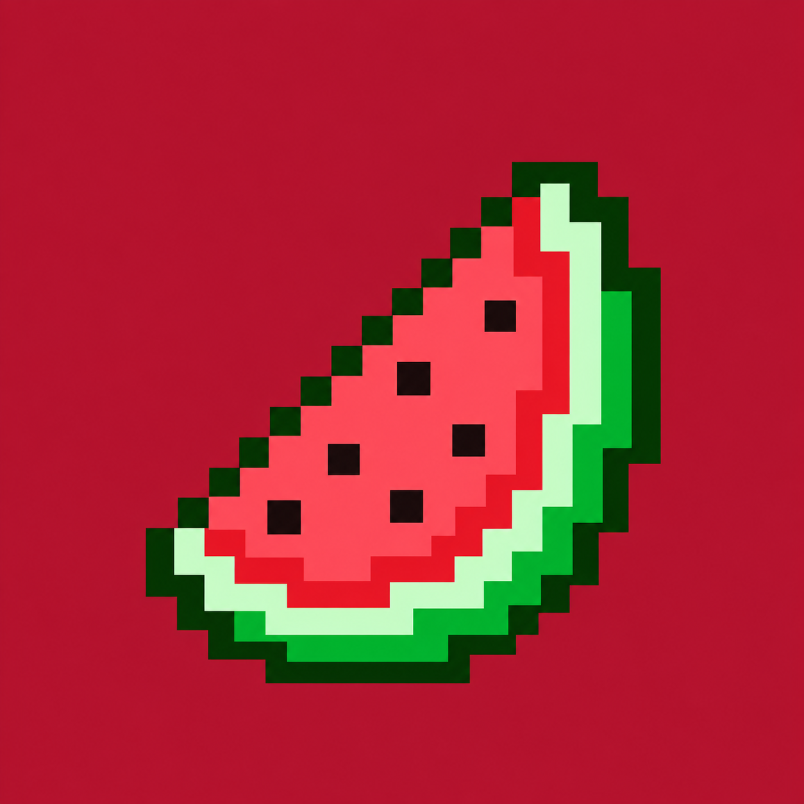

<p align="center"></p>

# 8bitBites

An open-source food, water and supplement diary for Android, built with Kotlin,
Jetpack Compose and Material 3. Your diary works offline and stays on your device.

[Türkçe](README.tr.md) · [Build](docs/BUILDING.md) · [AI](docs/AI.md) ·
[Database](database/README.md) · [Privacy](docs/PRIVACY.md) · [Contribute](CONTRIBUTING.md)

**Status:** early development. Current source: **0.5.1-dev**. Bundled food
catalogue: **0.4.0** with **2,193 foods**, including 260 ETİ products. Android 9
(API 28) or newer is required. Device testing is still in progress.

## What you can track

- **Food:** search the bundled Turkish catalogue, create personal foods, save
  favourites, or explicitly search Open Food Facts and USDA FoodData Central.
  Portions use grams; missing nutrients stay unknown. The last meal you select
  is remembered for the next entry.
- **Water:** choose a target and custom ml/L serving. The plus button records
  that serving. A 2,000 ml goal with a 100 ml serving shows 20 glasses; servings
  of **700 ml or more** use bottles. History, deletion and undo are available.
  The optional adult water reference never overwrites your target. See
  [how the suggestion works](docs/HYDRATION.md).
- **Supplements:** tick **This is a supplement** when adding a food. It stays in
  its meal, appears in supplements and contributes nutrition once. Dietary
  protein, protein-powder mass and creatine are tracked separately.
- **Targets:** energy and water goals, optional protein/carbohydrate/fat goals
  (off by default), and user-defined protein-powder/creatine amount targets.

Tap the bottom-left profile photo for your diary, supplements and seven-day
trends. Optional cards collapse and can be hidden in settings. The top-right
gear opens settings; **Foods**, **Favorites** and **AI** have bottom navigation
tabs. Choose a profile photo, use Material You colours, or unlock the included
theme pack with seven quick taps on the version label.

English is the default UI language. Turkish, German, French, Spanish, Italian,
Portuguese and Japanese are included. Offline English/Turkish food-term aliases
help searches; product names and external responses keep their source language.

## AI meal entry

Describe a meal, select a photo or take one inside the app. Recognition produces
a draft: choose matching database foods, check the portions and confirm before
saving. Model-generated nutrient values are not written into your diary.

- **On device:** download a supported, pinned LiteRT-LM model from Hugging Face
  inside the app, or import a compatible `.litertlm` file. Downloads support
  background progress, pause/resume and integrity checks. Photo recognition
  requires a compatible multimodal model and sufficient device memory.
- **Your API key:** use OpenAI, Gemini or an HTTPS OpenAI-compatible endpoint.
  API keys remain in session memory. Only submitted text and selected photos are
  sent to the chosen provider; there is no automatic cloud fallback.

No model is bundled. A ChatGPT subscription or free ChatGPT account is not an
API credential. See [AI setup, model access and limitations](docs/AI.md).

## Health Connect and widgets

Health Connect writes are opt-in. Manual sync and automatic nutrition sync with
background retries are implemented. **Water and unlinked supplement logs remain
local** in this version. Full per-data-type and historical-range controls are
planned.

Two Android home-screen widgets provide daily nutrition totals and quick food,
AI and camera entry. Add them from Settings or your launcher's widget picker.
Widgets and background behaviour still need testing across physical devices.

## Independent database updates

The repository hosts a versioned SQLite catalogue under [`database/`](database).
The app checks app and catalogue versions separately when opened. A newer
catalogue can be installed from Settings without reinstalling the app; it is
size-, checksum-, schema- and integrity-checked before installation. You can
also import a compatible SQLite file yourself.

Data is compiled through voluntary contributions. Values may be inaccurate;
please check the product label. See the [data notice](database/NOTICE.md).

## Build and check

Install **JDK 17**, **Android SDK platform 36** and **build-tools 35.0.0**, then:

```sh
git clone https://github.com/8bitPrograms/8bitBites.git
cd 8bitBites
./gradlew :core:test :app:testDebugUnitTest :app:assembleDebug :app:lintDebug
python3 -m unittest discover -s scripts -p 'test_*.py' -v
python3 scripts/check_catalogue.py
```

On Windows use `gradlew.bat` and your Python 3 executable. The debug APK is
`app/build/outputs/apk/debug/app-debug.apk`. See [build instructions](docs/BUILDING.md)
for SDK configuration and [verification notes](BUILD-VERIFICATION.md) for results.
CI builds are development artifacts; signing keys are not distributed here.

The display name changed from **8bitBite** to **8bitBites**. The Android package
remains `org.eightbit.bite` so existing installations and data can be retained
when updating with an APK signed by the same key.

## Development

See [the changelog](CHANGELOG.md), [contribution guide](CONTRIBUTING.md) and
[release checklist](docs/RELEASING.md). Planned work includes meal reminders,
camera barcode scanning, recipes, backup/restore and expanded Health Connect
controls. These are not implemented features.

The application code is **GPL-3.0-or-later**; see [LICENSE](LICENSE). Model,
theme and external database licenses remain separate. Theme attribution and
runtime license notices are included in the app assets.
